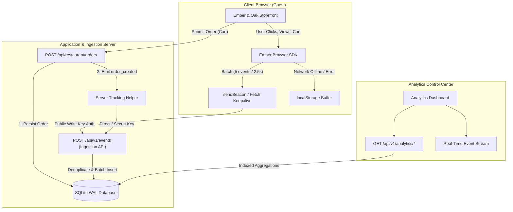

# Real-Time Event Analytics Platform & Restaurant Demo

> A high-reliability, full-stack analytics engine capturing browser interactions and server-side business transactions, with micro-batching, SQLite WAL storage, and real-time dashboard visualizations.

---

## 📌 Executive Summary

This project implements an end-to-end event analytics pipeline and integrates it into a live restaurant application (**Ember & Oak**) to demonstrate:
1. **Browser Analytics SDK**: Reusable client-side tracking library supporting automatic page tracking, custom event dispatching, user identification, micro-batching, session management, and unload-resilient delivery (`navigator.sendBeacon` / `keepalive`).
2. **Server Tracking Helper**: Lightweight, fault-tolerant backend client for emitting mission-critical transactional events (`order_created`) with built-in idempotency and context injection.
3. **Ingestion & Storage API**: High-throughput validation endpoint (`POST /api/v1/events`), deduplication engine, and indexed SQLite storage warehouse in WAL mode.
4. **Analytics Dashboard**: Real-time visualization of traffic trends, unique visitors, popular pages, conversion funnels, event distribution, and live raw JSON event inspector with date-range filtering.
5. **Restaurant Demo Application ("Ember & Oak")**: Artisanal wood-fired dining storefront demonstrating the complete event lifecycle from menu browsing to cart additions and server-tracked checkout transactions.

---

## 🛠️ Technology Stack & Architectural Rationale

| Layer | Technology | Rationale & Trade-offs |
|---|---|---|
| **Framework** | **Next.js 16 (App Router) + React 19** | Full-stack architecture unifying interactive client-side React components and secure server-side API routes with shared TypeScript data contracts. |
| **Language** | **TypeScript 5** | Strict type safety across Browser SDK, Server SDK, API routes, DB layer, and UI. |
| **Styling** | **Tailwind CSS v4 + Lucide Icons** | Ultra-modern dark-mode design system with glassmorphic cards and micro-animations. |
| **Storage Engine** | **SQLite via native `node:sqlite`** | Zero external native C++ build dependencies, single-file ACID persistence, WAL (Write-Ahead Logging) mode with `synchronous = NORMAL` for high concurrent read/write throughput. |
| **Backend Client Parity** | **TypeScript SDK + PHP/Laravel Helper** | Native TypeScript server tracker + standalone, PSR-compliant PHP/Laravel client (`src/lib/analytics/php-sdk/EmberAnalytics.php`) to demonstrate complete parity for Laravel-focused backend teams. |

---

## 🏗️ System Architecture & Data Flow



---

## 🔑 Core Features

### 1. Browser Analytics SDK (`src/lib/analytics/browser-sdk/`)
- **Micro-Batching**: Buffers events in memory and flushes every 2.5 seconds or immediately when 5 events accumulate.
- **Reliable Page Exit**: Uses `navigator.sendBeacon` and `fetch(..., { keepalive: true })` on `visibilitychange (hidden)` and `beforeunload` to eliminate dropped events on page navigation or tab closure.
- **Offline Resilience & Exponential Backoff**: Unsent events are written to `localStorage._ea_offline_queue`. On reconnection or retry, events are dispatched with exponential jitter.
- **Automatic Context Enrichment**: Enriches every event with viewport dimensions, screen resolution, document title, URL, referrer, locale, and timezone.
- **Single Page App Route Tracking**: Intercepts `history.pushState`, `history.replaceState`, and `popstate` to auto-track virtual page navigations.

### 2. Identity Resolution Model
- **Anonymous Visitor ID (`_ea_anon_id`)**: A persistent UUIDv4 stored in localStorage that survives browser restarts and page refreshes.
- **Sliding Session Window (`_ea_session_id`)**: Employs a 30-minute inactivity sliding window. Interactions refresh the expiration timestamp. If inactive for > 30 minutes, a new session ID is automatically minted.
- **Identity Aliasing (`identify()`)**: Calling `analytics.identify(userId, traits)` links the pre-existing anonymous ID to the verified customer profile in the `identities` table.

### 3. Server Tracking Helper (`src/lib/analytics/server-sdk/`)
- **Backend Business Telemetry**: Dispatches transactional events (e.g. `order_created`) directly from the server.
- **Idempotency Guarantee**: Accepts an `idempotencyKey` (such as the Order ID `evt_ord_...`). Retried order submissions or network hiccups never result in duplicate revenue or duplicate events.
- **Server Context**: Injects server environment (`production`/`development`), platform (`Node.js`/`PHP`), and host metadata.
- **PHP / Laravel Parity**: Standalone PSR-compliant class provided in `src/lib/analytics/php-sdk/EmberAnalytics.php`.

### 4. Database Schema & Indexing (`src/lib/db/index.ts`)
```sql
CREATE TABLE events (
  id TEXT PRIMARY KEY,
  event_id TEXT NOT NULL UNIQUE,       -- Deduplication key
  event_name TEXT NOT NULL,            -- e.g. 'page_view', 'order_created'
  source TEXT NOT NULL,                -- 'browser' | 'server'
  anonymous_id TEXT NOT NULL,          -- Visitor identifier
  user_id TEXT,                        -- Resolved customer identifier
  session_id TEXT NOT NULL,            -- 30-min sliding window session
  timestamp INTEGER NOT NULL,          -- Event occurrence epoch ms
  received_at INTEGER NOT NULL,        -- Ingestion arrival epoch ms
  page_url TEXT,
  page_path TEXT,
  page_title TEXT,
  referrer TEXT,
  properties TEXT NOT NULL,            -- JSON stringified custom payload
  context TEXT NOT NULL                -- JSON stringified device/server context
);

CREATE INDEX idx_events_timestamp ON events(timestamp);
CREATE INDEX idx_events_name ON events(event_name);
CREATE INDEX idx_events_session ON events(session_id);
CREATE INDEX idx_events_anon ON events(anonymous_id);
CREATE INDEX idx_events_path ON events(page_path);
CREATE INDEX idx_events_source ON events(source);
```

### 5. Analytics Dashboard (`src/components/dashboard/`)
- **KPI Summary Cards**: Total Page Views, Unique Visitors, Total Sessions, Bounce Rate, Orders Placed, Total Revenue, Avg Order Value, and Browser vs Server event split.
- **Interactive Time-Series Chart**: Visualizes traffic trends (Views vs Visitors vs Orders) across selectable grains (hourly/daily).
- **E-Commerce Conversion Funnel**: Step-by-step funnel visualization (`page_view` → `view_item` → `add_to_cart` → `begin_checkout` → `order_created`) with drop-off rates.
- **Popular Pages Table**: Top URL paths, page titles, view counts, and % traffic share.
- **Live Event Stream & JSON Inspector**: Real-time event log with expandable JSON payload and context inspectors.
- **Data Controls**: "Seed 7-Day Demo Data" and "Reset Data" buttons for immediate testing.

---

## 🚀 Quick Start Guide

### Prerequisites
- Node.js 22+ or Node.js 24+ installed on your system.

### Installation & Run
```bash
# 1. Install dependencies
npm install

# 2. Start development server
npm run dev
```

Open [http://localhost:3000](http://localhost:3000) in your browser.

---

## 🧭 Live Demo Walkthrough (What to show the interviewer)

1. **Top Navigation Bar**:
   - Toggle between **🍽️ Restaurant Store**, **📊 Analytics Dashboard**, and **📖 Architecture & SDKs**.
   - Note the **⚡ Debugger** button with live event counter in the top-right corner.

2. **Generate Telemetry in the Restaurant Store**:
   - Click dish cards (e.g. *Prime Tomahawk Ribeye*) → triggers `view_item`.
   - Click "Add to Cart" → triggers `add_to_cart`.
   - Open Cart drawer, adjust quantities, choose hospitality tip.
   - Click "Proceed to Checkout" → triggers `identify()` and `begin_checkout`.
   - Click "Place Order":
     - The browser sends the order payload to `/api/restaurant/orders`.
     - The backend creates the order record and invokes the **Server Tracking Helper** to emit `order_created` with Order ID idempotency!

3. **Inspect Events in Real Time**:
   - Open the **⚡ Debugger Dock** at the bottom-right: watch events appear with blue `browser` and purple `server` tags.
   - Click any event to inspect its payload, device context, and identity IDs.

4. **Review Analytics Dashboard**:
   - Switch to the **Analytics Dashboard** view.
   - Test date presets: "Today", "24h", "7 Days", "30 Days", "All".
   - View the **Traffic Trend chart**, **Conversion Funnel**, and **Popular Pages**.
   - Click **"Seed 7-Day Data"** to load realistic multi-day traffic patterns.
